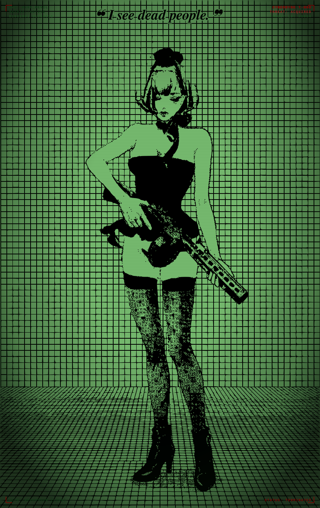

# ░▒▓ CYBER_GRID // TTY-09 // TERMINAL PHOSPHOR ▓▒░

<div align="center">

<!-- RETRO VECTOR ARTWORK: 100% Code-based SVG (Head-to-toe full body with heels & floor grid) -->
<a href="#-ascii--braille-terminal-render">
  
</a>

<br/>

[](#)
[](#)
[](#)
[](#)
[](#)

<br/>

> *"The sky above the port was the color of television, tuned to a dead channel."*  
> — **William Gibson, Neuromancer**

<p align="center">
  <a href="#-ascii--braille-terminal-render"><b>[ Text Art Showcase ]</b></a> •
  <a href="#-terminal-execution-one-liner"><b>[ Run in CLI ]</b></a> •
  <a href="#-developer-telemetry--bio"><b>[ System Specs ]</b></a> •
  <a href="#-how-to-use-in-your-github-profile"><b>[ Setup Guide ]</b></a>
</p>

</div>

---

## 📟 // ASCII & BRAILLE TERMINAL RENDER

> **Pure Unicode Matrix Display:** Rendered natively via 8-dot Braille Unicode glyphs (`U+2800`–`U+28FF`). Features the complete **standing figure from head to toe**, including her boots, heels, patterned fishnet stockings, and the perspective floor grid below her feet. No image upload required — 100% plaintext that renders in any terminal, editor, or Markdown viewer.

```text
⠀⡀⠀⡀⢀⠀⢀⠀⡀⠀⡀⢀⠀⢀⠀⡀⠀⡀⢀⠀⡀⠀⡀⢀⠀⡀⠀⡀⢀⠀⢀⠀⡀⢀⠀⢀⠀⡀⢀⠀⢀⠀⡀⠀⡀⢀⠀⢀⠀⡀⠀⡀⢀⠀⢀⠀
⠀⡀⠀⡀⠀⠀⠀⠀⠀⠀⡀⠀⠀⠀⠀⠀⠀⠀⢀⠀⠀⠀⠀⢠⠀⠀⠀⠀⢀⣀⣀⠀⡀⠀⠀⠀⠀⡀⠀⠀⢀⠀⡀⠀⡀⢀⠀⢀⠀⠀⠀⡀⠀⠀⢀⠀
⠀⠄⠀⠄⠠⠀⠠⠀⠄⠀⠄⠠⠀⠠⠀⠄⠀⠄⠠⠀⠄⠀⠄⠠⠀⢠⣤⣾⣿⣿⣿⣷⣶⣦⡀⠠⠀⠄⠀⠀⠠⠀⠄⠀⠄⠠⠀⠠⠀⠄⠀⠄⠠⠀⠠⠀
⠀⠄⠀⠄⠠⠀⠠⠀⠄⠀⠄⠠⠀⠠⠀⠄⠀⠄⠠⠀⠄⠀⠄⠠⠀⠁⢻⣿⣿⣿⣿⣿⣿⣿⡿⠠⠀⠄⠠⠀⠠⠀⠄⠀⠄⠠⠀⠠⠀⠄⠀⠄⠠⠀⠠⠀
⠀⠄⠀⠀⠀⠀⠀⠀⠀⠀⠄⠀⠀⠀⠀⠀⠀⠀⠰⠀⠀⠀⠀⠀⠀⣠⡟⠛⠿⠿⠿⠛⢻⡏⠠⠀⠀⠄⠀⠀⠀⠀⠀⠀⠀⠀⠀⠠⠀⠀⠀⠀⠀⠀⠠⠀
⠀⠂⠀⠂⠐⠀⠐⠀⠀⠀⠂⠀⠀⠐⠀⠂⠀⠀⠐⠀⠂⠀⠂⠐⢀⡟⠐⠂⠁⠀⠀⠒⠸⣿⡀⠐⠀⠂⠀⠀⠐⠀⠂⠀⠂⠐⠀⠐⠀⠂⠀⠂⠐⠀⠐⠀
⠀⠂⠀⠂⠐⠀⠐⠀⠂⠀⠂⠐⠀⠐⠀⠂⠀⠂⠐⠀⠂⠀⠂⠀⡾⡥⠀⠀⠀⠀⠀⡀⠀⣿⣧⠀⠀⠂⠐⠀⠐⠀⠂⠀⠂⠐⠀⠐⠀⠂⠀⠂⠐⠀⠐⠀
⠀⠂⠀⠀⠀⠀⠀⠀⠀⠀⠂⠀⠀⠀⠀⠀⠀⠀⠐⠀⠀⠀⠀⣸⢁⣇⣄⠀⠀⠀⣤⡆⠀⠸⣿⣤⢰⡆⠰⠀⠀⠀⠀⠀⠀⠐⠀⠀⠀⠀⠀⠀⠀⠀⠀⠀
⠀⠁⠀⠁⠈⠀⠈⠀⠁⠀⠁⠈⠀⠈⠀⠁⠀⠁⠈⠀⢱⠀⠁⡏⣼⢻⣿⢦⣼⣿⡿⢤⠄⠀⢾⣿⣼⡇⠈⡃⠈⠀⠁⠀⠁⠈⠀⠈⠀⠁⠀⠁⠈⠀⠈⠀
⠀⡁⠀⠁⠈⠀⠈⠀⠁⠀⡁⠈⠀⠈⠀⠁⠀⠁⢈⠀⢹⡀⢿⢀⣿⢸⡷⠶⠀⠀⠀⠶⣴⠞⠀⣼⢹⣿⠀⡇⠈⠀⡁⠀⠁⢈⠀⠈⠀⠁⠀⠁⠈⠀⠈⠀
⠀⡁⠀⡀⢀⠀⢀⠀⡀⠀⡁⢀⠀⢀⠀⡀⠀⡀⢈⠀⡀⠙⣿⡻⣿⣸⡇⠀⠀⠀⠀⠀⠀⠀⣴⣿⣾⣿⣸⡃⢈⠀⡁⠀⡀⢀⠀⢈⠀⡀⠀⡀⢀⠀⢀⠀
⠀⡀⠀⡀⢀⠀⢀⠀⡀⠀⡀⢀⠀⢀⠀⡀⠀⡀⢀⠀⡀⠀⡀⢙⠛⢿⢿⠄⢴⡤⠄⠀⣠⣾⣟⣷⣏⡁⢀⠀⢀⠀⡀⠀⡀⢀⠀⢀⠀⡀⠀⡀⢀⠀⢀⠀
⠀⡄⠀⠄⠀⠀⠠⠀⠀⠀⡄⠀⠀⠠⠀⠀⠀⠀⢠⠀⠄⠀⠀⠠⠀⠀⠈⣦⣄⣁⣤⣾⣿⣿⣿⣿⣿⡇⠀⠀⢠⠀⠀⠀⠀⢠⠀⠀⠀⠀⠀⠄⠀⠀⠠⠀
⠀⠄⠀⠄⠠⠀⠠⠀⠄⠀⠄⠠⠀⠠⠀⠄⠀⠄⠀⠀⠀⠀⠁⠀⠀⠀⠘⣿⣿⣿⣿⣿⣿⡟⠿⢿⣏⣄⣠⣄⣠⠀⠄⠀⠄⠠⠀⠠⠀⠄⠀⠄⠠⠀⠠⠀
⠀⠄⠀⠄⠠⠀⠠⠀⠄⠀⠄⠠⠀⠠⠀⠄⠀⠁⠀⠀⠀⠀⠀⠀⠀⠀⠀⠀⠘⠟⠿⣿⣿⡇⠀⠀⠀⠀⠀⠀⠀⠀⢢⠀⠄⠠⠀⠠⠀⠄⠀⠄⠠⠀⠠⠀
⠀⠆⠀⠀⠐⠀⠀⠀⠀⠀⠂⠀⠀⠠⠀⠀⠀⠀⠀⠀⠀⠀⠀⠀⠀⠀⠀⠀⠀⠀⠹⣦⣿⡇⠀⠀⠀⠀⠀⠀⠀⠀⠀⠁⠀⠰⠀⠐⠀⠀⠀⠂⠀⠀⠐⠀
⠀⠂⠀⠂⠐⠀⠐⠀⠂⠀⠂⠀⠀⠀⠀⠀⠀⠀⠀⣀⠀⠀⠀⠀⠀⠀⠀⠀⠀⠀⠀⣰⣿⡇⠀⠀⠀⠀⠀⠀⠀⠀⠀⢘⠂⠐⠀⠐⠀⠂⠀⠂⠐⠀⠐⠀
⠀⠂⠀⠂⠐⠀⢐⠀⠀⠀⠀⠀⠀⠀⠀⠀⠠⠄⠈⠁⠀⠀⠀⠀⠀⠀⠀⢠⠀⢠⣾⣿⠏⠀⠀⠀⠀⠀⠀⠀⠀⠀⠀⠘⠂⠐⠀⠐⠀⠂⠀⠂⠐⠀⠐⠀
⠀⠃⠀⠁⠀⠀⠊⠀⠀⠀⠀⠀⠀⠠⠀⠉⠀⠁⢨⣶⣶⣿⣿⣿⣿⣿⣿⣿⣶⣿⣿⣷⣦⣤⣄⣀⡀⠀⠀⠀⠀⠀⠀⠈⠀⠈⠀⠈⠀⠀⠀⠁⠈⠀⠈⠀
⠀⠁⠀⠁⠀⠁⠀⠀⠀⠀⠀⠈⠁⠈⠀⠁⠀⠁⢻⣿⣿⣿⣿⣿⣿⣿⣿⣿⣿⣯⣿⣿⣿⣿⣿⣿⣿⣿⡇⠀⠀⠀⠀⡁⠁⠈⠀⠈⠀⠁⠀⠁⠈⠀⠈⠀
⠀⡁⠀⡁⢈⠀⢐⢀⠀⠀⠀⠀⠀⢈⠀⡁⠀⠁⢈⠻⣿⣿⣿⣿⣿⣿⣿⣿⣿⣿⣿⣿⣿⣿⣿⣿⣿⣿⡇⠀⠀⠀⠀⡁⡁⢈⠀⢈⠀⡁⠀⡁⢈⠀⢈⠀
⠀⡀⠀⡀⢀⠀⢀⠀⡁⠀⠀⠀⠀⠘⢄⠄⠀⡀⢈⠀⣸⣿⣿⣿⣿⣿⣿⣿⣿⣿⣿⣿⣿⣿⣿⣿⣿⣯⡁⠀⠀⠀⢀⠀⡀⢀⠀⢀⠀⡀⠀⡀⢀⠀⢀⠀
⠀⡀⠀⡀⢀⠀⢀⠀⡀⠀⡃⣄⠀⠀⠈⠻⣆⡀⢀⠀⢸⣿⣿⣿⣿⣿⣿⣿⣿⣿⣿⣿⣿⣿⣿⣿⡿⡃⡀⠀⠀⠀⢨⠀⡀⢠⠀⢀⠀⡀⠀⡀⢀⠀⢀⠀
⠀⠄⠀⠄⠠⠀⠠⠀⠄⠀⢠⣿⣦⡀⠀⠀⠈⠻⣶⣠⣼⣿⣿⣿⣿⣿⣿⣿⣿⣿⣿⣿⣿⣿⣿⡿⠀⠄⠀⠀⠀⠀⢠⠀⠄⠠⠀⠠⠀⠄⠀⠄⠠⠀⠠⠀
⠀⠄⠀⠄⠠⠀⠠⠀⠄⠀⠜⠿⣿⣿⣦⡀⠀⠀⠈⠉⠛⠛⠿⠿⣿⣿⣿⣿⣿⣿⣿⣿⣿⣿⡟⠠⠀⠄⠄⠀⠀⠀⠰⠀⠄⠠⠀⠠⠀⠤⠀⠄⠠⠀⠠⠀
⠀⠆⠀⠄⠠⠀⠠⠀⠄⠀⠆⠀⠀⠨⠉⠻⠀⠀⠀⠀⠀⠀⣶⣦⣼⣟⢻⣿⣿⣿⣿⣿⣿⣿⡇⠀⠀⠆⠀⠀⠀⠀⠀⠄⠄⠠⠀⠰⠀⠄⠀⠆⠠⠀⠠⠀
⠀⠂⠀⠂⠐⠀⠐⠀⠂⠀⠂⠐⠀⠐⠀⠂⢦⠀⠀⠀⠀⠀⠈⢿⣷⣿⣿⣿⣾⣿⣿⣿⣿⣿⣷⣄⠀⠂⠰⠀⠀⠀⠀⠘⠂⠐⠀⠐⠀⠒⠀⠂⠐⠀⠐⠀
⠀⠂⠀⠂⠐⠀⠐⠀⠂⠀⠂⠐⠀⠐⢀⣢⣼⡄⠀⠀⢤⠐⣆⠈⢿⣿⣿⣿⣿⡿⣿⣿⣿⣿⣿⣿⣷⣦⡐⠀⠀⠀⠀⠀⠃⠐⠀⠐⠀⠒⠀⠂⠐⠀⠐⠀
⠀⠃⠀⠂⠐⠀⠘⠀⠃⠀⠃⣠⣤⣾⣿⣿⣿⣿⣦⣑⣌⣢⣸⣧⡌⢿⣿⣿⣿⣿⣿⣿⣿⣿⣿⣿⣿⣿⣿⡆⠀⠀⠀⠀⢸⠘⠀⠘⠀⠃⠀⠃⠀⠀⠘⠀
⠀⠁⠀⠁⠈⠀⠈⠀⠁⠘⠿⣿⢿⣿⡅⠙⢿⣿⣿⣿⡿⢿⣿⣿⣷⣾⣿⣿⣿⣿⣿⣿⡿⢿⣿⣿⣿⣿⣿⣿⢁⠀⠀⠀⠀⠈⠀⠈⠀⠁⠀⠁⠈⠀⠈⠀
⠀⡁⠀⡁⢈⠀⢈⠀⠁⠀⡁⠀⣾⣿⡟⡆⠀⠈⠉⠉⠀⠈⠿⠿⣿⣿⡿⠋⢹⣿⣿⣷⢴⣾⣟⢿⣿⡟⠛⣡⡎⠀⠀⠀⠀⣌⠀⢈⠀⡁⠀⡁⢈⠁⢈⠀
⠀⡁⠀⡀⢀⠀⢈⠀⡀⠀⡁⢀⠈⢻⠿⣦⣀⠀⠀⠀⠀⠀⠀⠀⢀⣾⣷⣄⣾⣿⣿⣿⣿⣿⣿⣶⣎⠿⣺⡉⠳⡄⡀⠀⠀⢹⠀⢀⠀⣀⠀⡁⢀⡀⢈⠀
⠀⡀⠀⡀⢀⠀⢀⠀⡀⠀⡀⢀⠀⢀⠀⡀⡀⠀⠀⠀⠀⠀⠘⣦⣾⣿⣿⣿⣿⣿⣿⣿⣿⡿⠛⠛⠻⡇⣌⣺⣦⠾⢷⡀⠀⠘⡀⢀⠀⡀⠀⡀⢀⠀⢀⠀
⠀⡄⠀⠄⠠⠀⠠⠀⠄⠀⡄⠠⠀⠠⠀⠄⠄⠀⠀⠀⠀⠀⠀⠈⢻⣿⣿⣿⣿⣿⣿⣿⠟⠀⠀⠀⠀⠘⢿⣷⣝⠻⢆⡙⢦⡠⢤⡠⠀⠄⠀⠄⠠⠀⠠⠀
⠀⠄⠀⠄⠠⠀⠠⠀⠄⠀⠄⠠⠀⠠⠀⠄⠀⠀⠀⠀⠀⠀⠀⠀⠀⠻⠿⢿⠿⠿⠋⠁⠀⠀⠀⠀⠀⠀⠀⡙⢟⢳⣌⠛⣤⣹⣆⠀⠠⠀⠀⠄⠠⠄⠠⠀
⠀⠆⠀⠄⠠⠀⠠⠀⠄⠀⠄⠠⠀⠠⠀⠄⠰⣄⡀⠀⠀⠀⠀⠀⠀⠀⠀⠀⠀⠀⠀⠀⠀⠀⠀⠀⠀⠀⠀⠄⠠⠑⣿⢳⢟⠡⣭⠣⣄⠡⠀⠄⠠⠀⠠⠀
⠀⠂⠀⠂⠐⠀⠐⠀⠂⠀⠂⠐⠀⠐⠀⠂⠐⣿⣿⣿⣿⣶⣶⣶⣶⣦⣤⠀⢀⣀⣤⣤⣤⣶⣶⣶⣶⣶⣴⠀⠐⠀⠆⡄⠸⢳⣌⢲⡮⠳⣃⠂⠐⠀⠐⠀
⠀⠂⠀⠂⠐⠀⠐⠀⠂⠀⠂⠐⠀⠐⠀⠂⠀⠿⣿⣿⣿⣿⣿⣿⣿⣿⣿⠀⢸⣿⣿⣿⣿⣿⣿⣿⣿⣿⡗⠀⠐⠀⠂⠐⠂⠸⠿⢳⣄⠷⠎⠳⣢⠀⠐⠀
⠀⠃⠀⠁⠈⠀⠈⠀⠁⠀⠃⠀⠀⠘⠀⠁⠀⠀⠀⢩⠉⠉⠉⣹⣿⣿⣿⠀⢸⣿⣟⠛⠛⢻⣿⣿⣿⣿⡇⠀⠈⠀⠁⠀⠁⠘⠀⠙⢿⣷⣌⠓⠘⣳⣎⠀
⠀⠁⠀⠁⠈⠀⠈⠀⠁⠀⠁⠈⠀⠈⠀⠁⠀⠁⠠⠈⠀⢀⡀⠈⢿⣿⣿⠁⠈⣿⣷⠶⠄⢸⣿⣿⣿⣿⠉⠀⠈⠀⠁⠀⠁⠈⠀⠈⠀⠙⢿⣷⣾⡟⠋⠀
⠀⡁⠀⡁⢈⠀⢈⠀⠁⠀⡁⢈⠀⢈⠀⡁⠀⠁⠘⠀⠀⠈⠁⠀⣾⣿⣿⡅⠀⢹⡇⠀⠀⢠⣿⣿⣿⣿⢀⠀⢈⠀⡁⠀⡁⢈⠀⢈⠀⡁⠀⡙⢉⠀⢈⠀
⠀⡀⠀⡀⢀⠀⢀⠀⡀⠀⡁⢀⠀⢀⠀⡀⠀⡀⢀⣇⠛⠀⠀⠀⠿⣿⣿⣇⠀⠘⠃⢀⡀⠈⣿⣿⣿⡏⢀⠀⢀⠀⡀⠀⡀⢈⠀⢀⠀⡀⠀⡀⢀⠀⢀⠀
⠀⡄⠀⡀⢀⠀⢀⠀⡀⠀⡀⢀⠀⢀⠀⡀⠀⡀⠀⠀⢏⠀⠲⠦⠀⣻⣿⣿⠀⠀⡀⠈⠀⢠⣿⣿⣿⡇⢀⠀⢀⠀⡀⠀⡀⢀⠀⢀⠀⡀⠀⡀⢀⠀⢀⠀
⠀⠄⠀⠄⠠⠀⠠⠀⠄⠀⠄⠠⠀⠠⠀⠄⠀⠄⠀⠀⠸⣦⡀⠀⠀⣾⣿⣿⠠⠀⡿⠀⠀⠘⣿⣿⣿⠅⠠⠀⠠⠀⠄⠀⠄⠠⠀⠠⠀⠄⠀⠄⠠⠀⠠⠀
⠀⠄⠀⠄⠠⠀⠠⠀⠄⠀⠄⠠⠀⠠⠀⠄⠀⠄⠠⠀⠠⠘⣇⢀⡀⣾⣿⣿⣷⠀⠅⠘⠇⠀⣻⣿⣿⠄⠠⠀⠠⠀⠄⠀⠄⠠⠀⠠⠀⠄⠀⠄⠠⠀⠠⠀
⠀⠆⠀⠀⠐⠀⠐⠀⠀⠀⠆⠀⠀⠰⠀⠂⠀⠂⠐⠀⠐⠀⢸⣮⣷⣿⣿⣿⣿⠀⠲⠀⠀⢸⣿⣿⣿⠀⠐⠀⠀⠀⠆⠀⠀⠰⠀⠐⠀⠂⠀⠂⠐⠀⠰⠀
⠀⠂⠀⠂⠐⠀⠐⠀⠂⠀⠂⠐⠀⠐⠀⠂⠀⠂⠐⠂⠐⠀⠐⢻⣿⣿⣿⣿⣿⠆⠀⠀⢠⣼⣿⣿⣿⡆⠐⠀⠐⠀⠂⠀⠂⠐⠀⠐⠀⠂⠀⠂⠐⠀⠐⠀
⠀⠂⠀⠂⠐⠀⠐⠀⠂⠀⠂⠐⠀⠐⠀⠂⠀⠂⠐⠀⠐⠀⠐⠘⣿⣿⣿⣿⣿⡆⠐⡀⠬⣿⣿⣿⣿⣷⠐⠀⠐⠀⠂⠀⠂⠐⠀⠐⠀⠂⠀⠂⠐⠀⠐⠀
⠀⠃⠀⠁⠈⠀⠈⠀⠁⠀⠃⠈⠀⠘⠀⠁⠀⠁⠀⠀⠈⠀⠀⠀⣿⣿⣿⣿⣿⣿⠀⢹⣷⣿⣿⣿⣿⣶⢻⠀⠈⠀⠁⠀⠁⠘⠀⠈⠀⠁⠀⠁⠈⠀⠈⠀
⠀⡁⠀⠁⠈⠀⠈⠀⠁⠀⠁⠈⠀⠈⠀⠁⠀⠁⠈⠁⠈⠀⠈⠈⣿⢿⡿⣿⣿⣿⡇⠀⢹⡿⢿⣿⣿⣿⠇⢃⠈⠀⠁⠀⠁⢈⠀⠈⠀⠁⠀⠁⠈⠀⠈⠀
⠀⡁⠀⡁⢈⠀⢈⠀⡁⠀⡁⢈⠀⢈⠀⡁⠀⡁⢈⠀⢈⠀⢈⠀⠁⠘⠃⢠⣿⢿⣇⢀⠈⣷⠎⠿⢆⣽⣤⡼⣇⠀⡁⠀⡁⢈⠀⢈⠀⡁⠀⡁⢈⠀⢈⠀
⠀⡀⠀⡀⢀⠀⢀⠀⡀⠀⡀⢀⠀⢀⠀⡀⠀⡀⢀⡀⢀⠀⣀⠀⡁⠀⣤⡞⠉⣿⣿⢀⠀⣹⣄⠈⠻⣿⣧⠀⢹⠀⡀⠀⡀⢀⠀⢀⠀⡀⠀⡀⢀⠀⢀⠀
⡀⣄⢀⢀⢀⠀⡀⡀⡀⢀⢄⢀⠀⠀⡀⡀⠀⢀⢀⢀⠠⡀⡀⡀⣼⠀⠙⠁⢀⣾⣿⢀⢀⢈⣟⣤⣾⢻⡛⣢⣼⣀⡄⡀⡀⡠⢀⢀⢀⢀⡀⡀⡀⡀⢀⢀
⠀⠀⠀⠀⠀⠀⠀⠀⠀⠀⠀⠀⠀⠀⠀⠀⠀⠀⠀⠀⠀⠀⠀⠀⠸⠀⠀⠴⢋⣻⣿⠀⠀⠀⠹⡿⣿⣾⣿⣿⣿⠇⠀⠀⠀⠀⠀⠀⠀⠀⠀⠀⠀⠀⠀⠀
⠀⠀⠀⠀⠀⠀⠀⠀⠀⠀⠀⠀⠀⠀⠀⠀⠀⠀⠀⠀⠀⠀⠀⠀⠀⡇⡾⠂⢐⣿⣿⠀⠀⠀⠀⢳⣿⣿⣿⣿⣿⡀⠀⠀⠀⠀⠀⠀⠀⠀⠀⠀⠀⠀⠀⠀
⠀⠀⠀⠀⠀⠀⠀⠀⠀⠀⠀⠀⠀⠀⠀⠀⠀⠀⠀⠀⠀⠀⠀⠀⠀⢻⣀⣴⣿⣿⡏⠀⠀⠀⠀⠀⢿⣿⣿⣿⣿⡇⠀⠀⠀⠀⠀⠀⠀⠀⠀⠀⠀⠀⠀⠀
⠀⠀⠀⠀⠀⠀⠀⠀⠀⠀⠀⠀⠀⠀⠀⠀⠀⠀⠀⠀⠀⠀⠀⠀⠀⠀⣿⣿⣿⣿⡇⠀⠀⠀⠀⠀⠘⣿⣿⣿⣿⡇⠀⠀⠀⠀⠀⠀⠀⠀⠀⠀⠀⠀⠀⠀
⠀⠀⠀⠀⠀⠀⠀⠀⠀⠀⠀⠀⠀⠀⠀⠀⠀⠀⠀⠀⠀⠀⠀⠀⠀⠀⣿⣿⣿⣿⠁⠀⠀⠀⠀⠀⠀⢻⣿⣿⣿⡇⠀⠀⠀⠀⠀⠀⠀⠀⠀⠀⠀⠀⠀⠀
⠀⠀⠀⠀⠀⠀⠀⠀⠀⠀⠀⠀⠀⠀⠀⠀⠀⠀⠀⠀⠀⠀⠀⠀⠀⢀⣿⣿⣿⣿⣦⡄⠀⠀⠀⠀⠀⠸⣿⣿⣿⣧⡀⠀⠀⠀⠀⠀⠀⠀⠀⠀⠀⠀⠀⠀
⠀⠀⠀⠀⠀⠀⠀⠀⠀⠀⠀⠀⠀⠀⠀⠀⠀⠀⠀⠀⠀⠀⠀⠀⠀⢸⣿⣿⣿⣿⣿⡇⠀⠀⠀⠀⠀⢸⣿⣿⣿⣿⣟⡀⠀⠀⠀⠀⠀⠀⠀⠀⠀⠀⠀⠀
⠀⠀⠀⡀⠀⠄⠀⠀⠀⠀⠀⠀⠀⢀⠀⠀⠀⡀⠀⠀⠀⠀⠀⠀⠀⢸⣿⣿⣿⣿⣿⣇⠀⠀⠀⠀⠀⠘⣿⣿⣿⣿⣿⡇⠀⠀⠀⠀⠀⠀⠀⠀⢀⠀⠀⠀
⡀⠁⡀⠀⠈⢀⠀⢀⠁⠠⠀⡘⠀⡄⠀⠁⢀⠁⠀⠀⠈⠀⠀⠀⠁⣼⣿⣿⣿⣿⣿⣿⡀⠀⠀⠁⠀⠀⢻⣿⣿⣿⣿⡄⠁⠀⠄⠀⡀⠀⠀⠡⠀⠀⠈⠄
⠀⠈⠀⠈⢀⠀⢀⠀⠀⠁⠀⠀⠐⠀⠈⠀⠀⠀⠀⠀⠀⠀⠀⠀⢠⣿⣿⣿⣿⣿⣿⣿⡇⢀⠀⠀⠀⠀⢸⣿⣿⣿⣿⣇⠈⠀⠈⡀⠐⠀⠁⠀⠁⠀⢂⠀
⠈⢀⠈⢀⠈⢀⠂⢀⠂⢀⠃⢀⠁⠀⠀⠀⠀⢀⠀⠀⠀⠀⠀⢀⣿⣿⣿⣿⣿⣿⣿⣿⠀⠈⠀⠀⠀⠀⢸⣿⣿⣿⣿⣿⠀⠀⡀⠀⠀⠁⠀⠁⠀⠁⠀⠁
⢀⠂⢀⠂⠀⠂⢀⠂⠀⠂⠀⠂⢀⠂⢀⠀⢀⠀⠐⠀⠐⠀⢀⣼⣿⣿⣿⣿⡿⠙⣿⡟⠀⠀⠀⠀⠀⠀⢸⣿⣿⣿⣿⣿⠐⠀⠀⠀⠁⠀⠁⠀⠀⠀⢀⠀
⠂⠀⠄⠀⠌⠀⠌⠀⠄⠀⠀⠀⠈⠀⠀⠀⠄⠀⠄⠀⣠⣴⣿⠿⢿⣿⣿⣿⡇⢰⣿⢷⡆⢰⡇⢰⡗⢰⣾⣿⣿⣿⣿⣿⣇⠀⠀⢀⠀⢂⠀⢂⠀⢀⠀⠠
⢀⠀⠀⠀⠀⡀⠀⡐⠀⡀⠀⠀⠀⢀⠀⢀⠀⢀⠀⣰⣿⣿⣿⣿⣿⣿⡿⢿⡃⢸⡇⣘⡇⢘⡇⠘⣇⣘⣿⣿⣿⣿⣿⣿⣿⢐⡄⠀⠀⠀⠀⠀⢀⠀⢀⠀
⠂⠀⡐⠀⡐⠀⢐⠀⢀⠂⢀⠂⠀⡂⠀⡂⠀⡀⠀⠘⠒⠺⠛⢻⠓⢸⣒⢺⡗⢒⡗⢒⣇⣒⣇⣂⣗⣒⣻⣷⣽⣿⣿⣿⢻⠒⠑⠀⠐⡀⠐⡀⠀⡂⠀⢂
⠀⠀⠀⠠⠀⠀⠀⠀⠄⠀⠄⠀⠀⠀⠠⠀⠀⠀⠀⠄⠀⠄⠀⠀⠀⠰⠀⠀⠀⠀⠄⠀⠄⠀⠀⠀⠠⠀⠸⠘⠛⠛⠋⠄⠀⠄⠀⠀⠀⠠⠀⠠⠀⠐⠄⠀
⡀⠁⢀⠁⢀⡈⠀⡈⠀⢀⠁⢀⠁⠀⡈⠀⡈⠀⢀⠀⠀⡁⠀⡁⠀⢈⠀⢈⠀⠀⡁⠀⣁⠀⢈⠀⢈⡀⠀⡀⠀⢁⠀⢁⠀⠈⡀⠈⡀⠀⢁⠀⢁⠀⠀⡀
⠀⠀⠆⠀⠔⠀⠠⠀⠀⠆⠀⠐⠀⠠⠀⠀⠄⠀⠀⠀⠠⠀⠀⠄⠀⠀⠀⠠⠀⠀⠄⠀⠀⠀⠠⠀⠀⠄⠀⠀⠀⠠⠀⠀⠄⠀⠄⠀⠠⠀⠀⠄⠀⠆⠀⠠
```

<br/>

<details>
<summary><b>[▶ Click to expand Wide Banner Grid Braille Art]</b></summary>

```text
⠀⠀⠀⠀⠀⠀⠀⠀⠀⠀⠀⠀⠀⠀⠀⠀⠀⠀⠀⠀⠀⠀⠀⠀⠀⠀⠀⠀⠀⠀⠀⠀⠀⠀⠀⠀⠀⠀⠀⠀⠀⠀⠀⠀⠀⠀⠀⠀⠀⠀⠀⠀⠀⠀⠀⠀⠀⠀⠀⠀⠀⠀⠀⠀⠀⠀⠀⠀⠀⠀⠀⠀⠀⠀⠀⠀⠀⠀⠀⠀⠀⠀⠀⠀⠀⠀⠀⠀⠀⠀⠀⠀⠀⠀⠀⠀
⠀⠀⠀⠀⠀⠀⠀⠀⠀⠀⠀⠀⠀⠀⠀⠀⠀⠀⠀⠀⠀⠀⠀⠀⠀⠀⠀⠀⠀⠀⠀⠀⠀⠀⠀⠀⠀⠀⠀⠀⠀⠀⠀⠀⠀⠀⠀⠀⢶⣿⣷⣦⠀⠀⠀⠀⠀⠀⠀⠀⠀⠀⠀⠀⠀⠀⠀⠀⠀⠀⠀⠀⠀⠀⠀⠀⠀⠀⠀⠀⠀⠀⠀⠀⠀⠀⠀⠀⠀⠀⠀⠀⠀⠀⠀⠀
⠀⠀⠀⠀⠀⠀⠀⠀⠀⠀⠀⠀⠀⠀⠀⠀⠀⠀⠀⠀⠀⠀⠀⠀⠀⠀⠀⠀⠀⠀⠀⠀⠀⠀⠀⠀⠀⠀⠀⠀⠀⠀⠀⠀⠀⠀⠀⢰⠏⠉⠉⣇⠀⠀⠀⠀⠀⠀⠀⠀⠀⠀⠀⠀⠀⠀⠀⠀⠀⠀⠀⠀⠀⠀⠀⠀⠀⠀⠀⠀⠀⠀⠀⠀⠀⠀⠀⠀⠀⠀⠀⠀⠀⠀⠀⠀
⠀⠀⠀⠀⠀⠀⠀⠀⠀⠀⠀⠀⠀⠀⠀⠀⠀⠀⠀⠀⠀⠀⠀⠀⠀⠀⠀⠀⠀⠀⠀⠀⠀⠀⠀⠀⠀⠀⠀⠀⠀⠀⠀⠀⠀⠀⠀⣮⣤⣠⡆⢻⣴⠀⠀⠀⠀⠀⠀⠀⠀⠀⠀⠀⠀⠀⠀⠀⠀⠀⠀⠀⠀⠀⠀⠀⠀⠀⠀⠀⠀⠀⠀⠀⠀⠀⠀⠀⠀⠀⠀⠀⠀⠀⠀⠀
⠀⠀⠀⠀⠀⠀⠀⠀⠀⠀⠀⠀⠀⠀⠀⠀⠀⠀⠀⠀⠀⠀⠀⠀⠀⠀⠀⠀⠀⠀⠀⠀⠀⠀⠀⠀⠀⠀⠀⠀⠀⠀⠀⠀⠀⠀⠲⣿⡏⠀⠘⣱⡿⠔⠀⠀⠀⠀⠀⠀⠀⠀⠀⠀⠀⠀⠀⠀⠀⠀⠀⠀⠀⠀⠀⠀⠀⠀⠀⠀⠀⠀⠀⠀⠀⠀⠀⠀⠀⠀⠀⠀⠀⠀⠀⠀
⠀⠀⠀⠀⠀⠀⠀⠀⠀⠀⠀⠀⠀⠀⠀⠀⠀⠀⠀⠀⠀⠀⠀⠀⠀⠀⠀⠀⠀⠀⠀⠀⠀⠀⠀⠀⠀⠀⠀⠀⠀⠀⠀⠀⠀⠀⠀⠀⢱⣭⣾⣿⡿⠀⠀⠀⠀⠀⠀⠀⠀⠀⠀⠀⠀⠀⠀⠀⠀⠀⠀⠀⠀⠀⠀⠀⠀⠀⠀⠀⠀⠀⠀⠀⠀⠀⠀⠀⠀⠀⠀⠀⠀⠀⠀⠀
⠀⠀⠀⠀⠀⠀⠀⠀⠀⠀⠀⠀⠀⠀⠀⠀⠀⠀⠀⠀⠀⠀⠀⠀⠀⠀⠀⠀⠀⠀⠀⠀⠀⠀⠀⠀⠀⠀⠀⠀⠀⠀⠀⠀⠀⠀⠀⠀⠀⠉⢿⡇⠀⠀⠀⠀⠀⠀⠀⠀⠀⠀⠀⠀⠀⠀⠀⠀⠀⠀⠀⠀⠀⠀⠀⠀⠀⠀⠀⠀⠀⠀⠀⠀⠀⠀⠀⠀⠀⠀⠀⠀⠀⠀⠀⠀
⠀⠀⠀⠀⠀⠀⠀⠀⠀⠀⠀⠀⠀⠀⠀⠀⠀⠀⠀⠀⠀⠀⠀⠀⠀⠀⠀⠀⠀⠀⠀⠀⠀⠀⠀⠀⠀⠀⠀⠀⠀⠀⠀⠀⠀⣀⣠⣤⣠⣠⣞⣁⠀⠀⠀⠀⠀⠀⠀⠀⠀⠀⠀⠀⠀⠀⠀⠀⠀⠀⠀⠀⠀⠀⠀⠀⠀⠀⠀⠀⠀⠀⠀⠀⠀⠀⠀⠀⠀⠀⠀⠀⠀⠀⠀⠀
⠀⠀⠀⠀⠀⠀⠀⠀⠀⠀⠀⠀⠀⠀⠀⠀⠀⠀⠀⠀⠀⠀⠀⠀⠀⠀⠀⠀⠀⠀⠀⠀⠀⠀⠀⠀⠀⠀⠀⠀⠀⠀⠀⠀⠀⢿⣿⣿⣿⣿⣿⣿⣿⡇⠀⠀⠀⠀⠀⠀⠀⠀⠀⠀⠀⠀⠀⠀⠀⠀⠀⠀⠀⠀⠀⠀⠀⠀⠀⠀⠀⠀⠀⠀⠀⠀⠀⠀⠀⠀⠀⠀⠀⠀⠀⠀
⠀⠀⠀⠀⠀⠀⠀⠀⠀⠀⠀⠀⠀⠀⠀⠀⠀⠀⠀⠀⠀⠀⠀⠀⠀⠀⠀⠀⠀⠀⠀⠀⠀⠀⠀⠀⠀⠀⠀⠀⠀⠀⣄⠐⢦⣀⣿⣿⣿⣿⣿⣿⡟⠀⠀⠀⠀⠀⠀⠀⠀⠀⠀⠀⠀⠀⠀⠀⠀⠀⠀⠀⠀⠀⠀⠀⠀⠀⠀⠀⠀⠀⠀⠀⠀⠀⠀⠀⠀⠀⠀⠀⠀⠀⠀⠀
⠀⠀⠀⠀⠀⠀⠀⠀⠀⠀⠀⠀⠀⠀⠀⠀⠀⠀⠀⠀⠀⠀⠀⠀⠀⠀⠀⠀⠀⠀⠀⠀⠀⠀⠀⠀⠀⠀⠀⠀⠀⠈⠛⠳⠀⠉⢩⣿⣿⣿⣿⣟⠀⠀⠀⠀⠀⠀⠀⠀⠀⠀⠀⠀⠀⠀⠀⠀⠀⠀⠀⠀⠀⠀⠀⠀⠀⠀⠀⠀⠀⠀⠀⠀⠀⠀⠀⠀⠀⠀⠀⠀⠀⠀⠀⠀
⠀⠀⠀⠀⠀⠀⠀⠀⠀⠀⠀⠀⠀⠀⠀⠀⠀⠀⠀⠀⠀⠀⠀⠀⠀⠀⠀⠀⠀⠀⠀⠀⠀⠀⠀⠀⠀⠀⠀⠀⠀⠀⣀⣠⣤⣠⣠⡻⣿⣿⣿⣿⣷⣄⠀⠀⠀⠀⠀⠀⠀⠀⠀⠀⠀⠀⠀⠀⠀⠀⠀⠀⠀⠀⠀⠀⠀⠀⠀⠀⠀⠀⠀⠀⠀⠀⠀⠀⠀⠀⠀⠀⠀⠀⠀⠀
⠀⠀⠀⠀⠀⠀⠀⠀⠀⠀⠀⠀⠀⠀⠀⠀⠀⠀⠀⠀⠀⠀⠀⠀⠀⠀⠀⠀⠀⠀⠀⠀⠀⠀⠀⠀⠀⠀⠀⠀⠀⠘⢻⣏⠛⠛⠻⢿⡿⣿⣿⣿⣿⢿⡄⠀⠀⠀⠀⠀⠀⠀⠀⠀⠀⠀⠀⠀⠀⠀⠀⠀⠀⠀⠀⠀⠀⠀⠀⠀⠀⠀⠀⠀⠀⠀⠀⠀⠀⠀⠀⠀⠀⠀⠀⠀
⠀⠀⠀⠀⠀⠀⠀⠀⠀⠀⠀⠀⠀⠀⠀⠀⠀⠀⠀⠀⠀⠀⠀⠀⠀⠀⠀⠀⠀⠀⠀⠀⠀⠀⠀⠀⠀⠀⠀⠀⠀⠀⠀⠉⠀⠀⠐⢾⣿⣿⣿⠟⠻⣵⣶⢄⠀⠀⠀⠀⠀⠀⠀⠀⠀⠀⠀⠀⠀⠀⠀⠀⠀⠀⠀⠀⠀⠀⠀⠀⠀⠀⠀⠀⠀⠀⠀⠀⠀⠀⠀⠀⠀⠀⠀⠀
⠀⠀⠀⠀⠀⠀⠀⠀⠀⠀⠀⠀⠀⠀⠀⠀⠀⠀⠀⠀⠀⠀⠀⠀⠀⠀⠀⠀⠀⠀⠀⠀⠀⠀⠀⠀⠀⠀⠀⠀⠀⠀⠀⠀⢀⡀⠀⠈⠛⠋⠁⠀⠀⠈⠳⠷⣦⢀⠀⠀⠀⠀⠀⠀⠀⠀⠀⠀⠀⠀⠀⠀⠀⠀⠀⠀⠀⠀⠀⠀⠀⠀⠀⠀⠀⠀⠀⠀⠀⠀⠀⠀⠀⠀⠀⠀
⠀⠀⠀⠀⠀⠀⠀⠀⠀⠀⠀⠀⠀⠀⠀⠀⠀⠀⠀⠀⠀⠀⠀⠀⠀⠀⠀⠀⠀⠀⠀⠀⠀⠀⠀⠀⠀⠀⠀⠀⠀⠀⠀⠀⠸⣿⠿⣿⡇⢶⣿⣿⣿⡇⠀⠀⠿⣷⣧⢄⠀⠀⠀⠀⠀⠀⠀⠀⠀⠀⠀⠀⠀⠀⠀⠀⠀⠀⠀⠀⠀⠀⠀⠀⠀⠀⠀⠀⠀⠀⠀⠀⠀⠀⠀⠀
⠀⠀⠀⠀⠀⠀⠀⠀⠀⠀⠀⠀⠀⠀⠀⠀⠀⠀⠀⠀⠀⠀⠀⠀⠀⠀⠀⠀⠀⠀⠀⠀⠀⠀⠀⠀⠀⠀⠀⠀⠀⠀⠀⠀⠀⢽⡾⣽⣧⢸⡷⣿⣿⠃⠀⠀⠀⠈⠳⠋⠀⠀⠀⠀⠀⠀⠀⠀⠀⠀⠀⠀⠀⠀⠀⠀⠀⠀⠀⠀⠀⠀⠀⠀⠀⠀⠀⠀⠀⠀⠀⠀⠀⠀⠀⠀
⠀⠀⠀⠀⠀⠀⠀⠀⠀⠀⠀⠀⠀⠀⠀⠀⠀⠀⠀⠀⠀⠀⠀⠀⠀⠀⠀⠀⠀⠀⠀⠀⠀⠀⠀⠀⠀⠀⠀⠀⠀⠀⠀⠀⠀⠘⣷⢿⣿⠈⡟⣿⣿⠀⠀⠀⠀⠀⠀⠀⠀⠀⠀⠀⠀⠀⠀⠀⠀⠀⠀⠀⠀⠀⠀⠀⠀⠀⠀⠀⠀⠀⠀⠀⠀⠀⠀⠀⠀⠀⠀⠀⠀⠀⠀⠀
⠀⠀⠀⠀⠀⠀⠀⠀⠀⠀⠀⠀⠀⠀⠀⠀⠀⠀⠀⠀⠀⠀⠀⠀⠀⠀⠀⠀⠀⠀⠀⠀⠀⠀⠀⠀⠀⠀⠀⠀⠀⠀⠀⠀⠀⠀⢹⣿⣿⡆⣿⣿⣗⠀⠀⠀⠀⠀⠀⠀⠀⠀⠀⠀⠀⠀⠀⠀⠀⠀⠀⠀⠀⠀⠀⠀⠀⠀⠀⠀⠀⠀⠀⠀⠀⠀⠀⠀⠀⠀⠀⠀⠀⠀⠀⠀
⠀⠀⠀⠀⠀⠀⠀⠀⠀⠀⠀⠀⠀⠀⠀⠀⠀⠀⠀⠀⠀⠀⠀⠀⠀⠀⠀⠀⠀⠀⠀⠀⠀⠀⠀⠀⠀⠀⠀⠀⠀⠀⠀⠀⠀⠀⠀⢻⣿⣇⢾⣿⣿⡄⠀⠀⠀⠀⠀⠀⠀⠀⠀⠀⠀⠀⠀⠀⠀⠀⠀⠀⠀⠀⠀⠀⠀⠀⠀⠀⠀⠀⠀⠀⠀⠀⠀⠀⠀⠀⠀⠀⠀⠀⠀⠀
```

</details>

<details>
<summary><b>[▶ Click to expand Classic 7-Bit ASCII Version (@%#*+=-:. )]</b></summary>

```text
`- ^ :  ' , :  ` : ^ _ '' _ = : -    ' , : '' _ = : -- = = -` _ ^ .
`' ; _  : ^ , `. _ = , '' , > , .c|5eEs^ ' `. , ; , -' > ; '. , ; -`
 ' = ,  ' = _ `- _ ^ , .` _ ; ,|V@@@@@@KUS*.- _ ^ , .. = ; -` , ^ '.
`' = ,  ' = _ `. _ ^ , -. _ = =?##$%%m%mX@m:  _ = , .- , ; -` ^ , '-
 - = _  ' ^ ,  . , ^ , `  , ^ `TbG#@@@Apour ` _ > , -- ^ ^ '. , ^ -`
 ' ; _  ' ^ ,  . , , _ `  _ ^ ah;`z;;=''4s _  _ ; , .. ^ = :- , ^ -`
 - ^ _  ' ; ,  . : , , '' ' '^E;?     ` ]@    _ = , .. ^ ; -` = , -.
`- , :  : = _ '' _ ^ ^ .` : '[v         vbo . : = _ .- ^ ; -  ^ ^ -`
 ' , '  ' ^ ,  ` ^ = : '. : I;,-      c `q@r'c: > : .' = ^ '` _ ; -
 ' ^ :  ' = ,  ` , , , .` `=i:C(s  :!k*  'VEzoz L ^ -' = = -  ^ = '`
`' = _  ' = : `- : ^ = '! '7>2ubhvIX@d<+  y$]5l c ^ .. = > -` = ; :.
`- = _  ' = ' .- : ^ = 'T i>v9v%nF'`^ 7|i|,?ZnV <!- -. , < -. ^ ; -.
 - ; ,  ' = ,  . , ; _  Jfufaw7U:     'TI_ qy1$-3*` -' ^ = :. = = -.
 ' ; ^  - = =  ` = ; _ --c5ukU36          9@yewc7 _ .' = ^ :- = , -.
`- , ,  : = ^ `. , = , -` -'[o4]} T}<   rkquZT_ ^ , -' ^ = :- = ^ -.
.' ^ _ `, = _ .' : , ; .  : = _.|- r  r]@H6XUX{ = ^ .` , > '` = ; -`
`' = _ `_ ; : `- _ , =`:''<.r = iAFLcyd8H@@@Xw* = ,  ` ^ < -` = ; '.
 ' ; ,  ' = _  ` , ; _          vm@@@mOXdF5kZ+<:z-+`.  = ; -` = = '.
 ' > =  - = ^  ` = .              ,VjP@@&           ,= ; ^ :. ^ ^ '.
 - > ,  - ^ ^ `- _                  'nCh$/           ;;- ^ :. ^ = -`
 ' > : `: ^ : -                      sF1U?            *_ > '` = = .`
`' = _  _ <           _!              >m@.            ^! < .` ; ; -`
`' , _''             <r              u@@L             ^! > -` = ; '-
`' : =`          ':c `  .>!!rrc!Tn,*X@K^       '      <= = :. , = :'
 . >:         '' ^ ^ tU%@@@@@@@@@@%b%$mh9j17s.        r, ^ '. ^ = '-
 - <,       ' .- _ _ O@$@$%%%%$$$$@be$@@@@@@@@U5      <: > .  ; ^ -.
 ' ^ =        -  _ ; *X@######@@###@U&&%#$%%%%@9     -;- ; .  = = .
 ' ^ ^;-      -: = , '_3%###@@#####$@@@@@####$UI     _^: ^ '. , = -`
`- ^ ^  ,      ;/; _ ;  m@#@@#######@@####@##$x;     ;'^ = -- ^ ^ _'
`- < ^  ' !     ,n1c - `A@#@@#@##@@@@@@####$@b!-     ! , > '` = = '-
 ' > _ `_ :7x     {wf/` w$%##@#@#@#@@@@#@#$@E'.>     ; = ; '  = ; -.
 ' = , `' ^V@X)     sxtqK@@@@##$@#@###@@@#@p` ''     > , > '` = = -`
`' ^ =  . =3dGmh*     ;r?iZSG@@@@@####@@#@E,  -_     ^ = ; '- = = '`
`- ; =  ' < _->F3I        >^-kdaHm@@@#@@$@; ` :-     `^, = :- ^ ; :'
`' > , `_ ; ^    *<       )@43ylw2aHm@#@$@v   ^ `     c= ; '` = ; ''
 ' > ^ `: = ; `' -+-       !Hk2hA9[5PX@@###kL   >      * < '` ; ; '-
 ' > , `' < ^    /)3   :':} =UG6wVdt{3d8#@#@@kv >      ! ; -. ^ ; '`
`' ; = `, ^ _ <eG@@mC,c=s`F2 <UKbkUOku5H8@@#$@@b[.     :,: '. ^ ; '`
`' ; = `' T3GA##j%@@@dYq]dE@X,F&GbUw2ol52VO#@#%@$z      ;' '` = = '-
-: > _ -: 5UOj%2 !um@@@$]@@#@8A@@KGy[I|77IaUK%@@@3:     `= -` ^ ; ''
`' ; =  ' , ^E@d)^ _,rJ. .G8%@@$Vo{]VO2vvtEYhw]{T{/-    ^! '` ^ ^ ::
 ' > =  ' > ^YU@ws          `,ekr-c1d%dlokP7}tx'vS}-    _T .` ; ; ''
 - > = `: = ^ ,LF3*          <SxE5G&#@K@mmHK&5Ieu `;/    i '. ; > '-
 ' ; =  ' < >    :^       ;E5hwwm@@$@XXXVx/crklr7ZuslI:  > '- > = -`
.: > ,  : ! ;  ' >r        `t4wH#%&H%HXhT     :6AnI[Z/z< .^'- ; ^ '.
.: > , `_ + , `: >:          sk@@@8XO]('        7jk1?v3;r>.;' _ , :'
`- ; = `: = _ .: ^            'uo]n7=            zfntiJ(3L<  :^ ; :'
 . = =  : = , .: _ c                            - ':iU(Z3zlz: = ^ '.
`- ; = `' = = .' , hHEnFJT*+c>.          =!!r!, ^ ^ r!`=CT|+Iv*/, '.
`' > ^  ' < =  - ; f@@@@@@@@@@@8i !}jdH8&@@@@@@&< = -+,'`[]}n*JsL  `
-: > ^ `' r = `' ! >EU#@@@@@$@%@n T@@@@@@@@@@#@P. = :' + 7P[x|5zr*T:
`' ; ,  : < _ `: ; -_r7FJ(J(njE6l !2kqwqwhpdhwqt- ; .  , ! <kHjsns>T
 ' ; =  : ; , `: ^ --<z?==<cFnS]n ,C{L/+;veeoeuJ' > .  = > ` *U#Y!v9
 ' > , `' ; _ `' ^ _ <Tc!7z>clk]5.`}{sCL>styynur  > -` ^ < -` ;JU@8o
 ' > ;  : = ^  ' > _ :sz*sc>?ItZy; !uJ;c>JnInZo'` ; '. , = '` , ;+,
.' ; _  ' > ^ `: < :  *vf>!^vu{3xz _}v<<;|o1t[3 ' = :. ^ > -` ^ = '.
.' ; _  ' > , `: ; , `rcz*?L!?{Y2J -!<L7<?ioxZT ^ ; '. ^ > :` = ^ '.
.- = ^  : ; , `: = ^ .`_s^7f/*vo53-`!c=!+(Zll5r = > -` = > -` , ^ ''
`: > ^ `' < , `: ; = `- )(+<!<3eI{> =u,==(Yt1o_ , + '` ^ < '` ; = '-
`_ ; ,  ' ; ^ `' > ,  ' ,IF+>r)|jxT .T?C=<Fj]o` : + '. ^ ; '` = > :.
`: > , ._ ; = `' > _ `_ , )zFJvlyI{'-s!T!/}to5  ^ ; '` = ; :' ^ > :`
`- > ^  _ ; ^ `: = _ ', ^ ;3CI{13C[v C!;<}]33u  , > '. , < '` = = '-
.- ; =  ' < _ .' > ^ .: ^ :JIC7jx1oI.<+!z7o5Ew. ^ = '. _ ! -  ; ^ ''
.: = ^  ' > ^  : ; = -: = :`fIFowoh1`<</3FoEqo( : ; -  ^ ; '` ^ = :-
`: > ^ `_ = ;  - < , .' > ^ ?w5x2ywo-:|?s}kknIt?. = -` ; = :. , ; :.
 ' < ,  : ; , `' ; = `: = , zwxaaqny? vE(|5waeT|! = '. , < '` = ; '`
`- > ^  ' > _ ._ = , ': ; _ su3eou3on -To]1I1nu?/`: '` _ ! -` > = -.
.' = =  - > ^  ' < , `' = ^ +T)Z?s{Zx;` FCTF{|FTcvr .  = > '. ; ^ '-
-: = , `: = ; `' > , .: = ^ ,cr?r7Y(3J  '(c|ovvT?({ -` ; = :- , ^ :'
`: ; : `_ ; , .: ^ , .' ; , .*<r?J}zfe-  1?r*7[{s<T -- , < '` , ; :-
`' < _  : > : .: = ^ .: = ^  TrsJz!J3e:  )Fz?v}f7*)^-- , < -  = > '.
`- > =  - < ,  - > , ._ > ^  Fcz/Tsf3u_  _Tv(u7vJF1c'' ^ < -` ; > '`
`- ; =  . ; =  . < , `' > =  ?*czIs?jl`  ',3Lf3I}|i*'' = > -. > = '.
`' ; ^ `' ^ ^ `' ; ^ .: = _  !/?vcr|pF   ^ 7|71j]t|!.. = = '. ; ^ '-
`: ; _ `_ ; _ .: = ^ -_ ^ ,  :*7scfyqr`  _ ,|ee[5enT.. , = _. ^ = '-
.: ; _  _ < _ ._ > _ '_ > ,  -_{)|xu5-' `: _`a5eeux{'' _ < :` , ; '-
.' ; ^  ' < ,  ' + ^ .' > ^  _ 3uf|IE : `_ > ?xnS5nF`  , ! -  = ; :-
`' > =  - > ;  ' ! = `' ; =  _ Fn1eY2 _  _ + -5ty]yI.  ^ > -  ; ; :.
`' < = `: ; = .: > ^ -' = =  , )ynkao '  _ +  JEjx2o   ^ ^ '- = ; '.
`' < ; `_ > , ._ = ^ '_ = ^ `, uwY2EOhT ., < -_xwStot- ^ = :. ^ ; -.
`' ; ;  : < , -, > ^ '_ ; _ .'^@Eh&$#@I `_ > `tb]2xk@T , + _. = = ''
`_ ; ,  ' > ^  ' + , `' ; ,  .s#ASXKK%C  : > `r&%m%@hE^. < -  = ^ :-
,, r < '= r ! ': r < '_ < ; `'*@$hAmU#w '= r :.d@#&m5S!= r _: + ! ,,
= +`^^ r +''< c =_.r +-'> r :.}@hA@@m%HT.! !`::|#K%$KG!>-:< ! ^,.r ;
 >`', > ', < =' > ^. < ^' < -!m@d6@##@8E ; _' ,z@X@@@@n + =. > ;`.=
< '; <''< <`.> < `> ^' + := ,h@Hk&#@@%m{ < `= ')@%@@#A9 '^ < -; < .>
 .< =' + =, ! _, ;..= :_`,_ (@@&8@@@Hm9, ,` ; `!XAm@#XU< ,- + __ ! `
'< ,_ + -+ >- ! =. ! =- < :7X@8VG#A,u#[- .' ,` >Ub%@@@%/- < `; ;- >
; '^ >- ! := +''< ;. ! ';s6@mGw4#@| [@nr=z*,/c>T$kX$&$@}'. > _, +  !
 .> __ +` < ', >  ; _: tH@XEe2m@@dsTu}JFr7vzC*?umpG8H##U!< '^ ;` !
 = `^ ,' <  < -^ ^. ;`LpXXmmmGdku|?+i**|;?T!Fs!E6j@@@#@@sL* ^  >  =
;  =  = :_ ;` ;  ; -, ++;FTL}c?(<|Fr|s/FcL7r7|!3%]q$@@Xy?,r  ;  = .=
  =  _  ^  , .- '` ^  _  ^  , := ^_ ^` !.`! _z,*}PH%pe= >  ,  _ `. -
```

</details>

---

## ⚡ // TERMINAL EXECUTION (ONE-LINER)

Print this artwork directly inside your local terminal with authentic retro **green phosphor CRT ANSI colors**:

```bash
# Clone and run directly:
git clone https://github.com/<your-username>/<your-repo>.git
cd <your-repo>
./view_art.sh
```

Or pipe directly into your terminal or `.bashrc` / `.zshrc` / `fastfetch` startup banner:

```bash
# Output full-body Braille art
cat assets/braille_fullbody.txt

# Or execute with CRT phosphor green ANSI color styling:
curl -sSL https://raw.githubusercontent.com/<your-username>/<your-repo>/main/view_art.sh | bash
```

---

## 🛰️ // DEVELOPER TELEMETRY & BIO

```yaml
# SYSTEM IDENTITY & HARDWARE SPECS
user:
  handle: "OPERATOR_09"
  role: "Full-Stack Engineer // Systems Architect // Cyberpunk Rice Enthusiast"
  location: "Neo-Shinjuku // Serilingampalle"
  status: "ONLINE // COMPILING"
  alignment: "Chaotic Modular"

runtime:
  os: "Arch Linux / Hyprland / NixOS"
  shell: "zsh + tmux + starship"
  editor: "Neovim (NVIM v0.10+ / Lua)"
  terminal: "Kitty // Alacritty [Phosphor Green Palette #75b870]"

telemetry:
  uptime: "99.98%"
  caffeine_intake: "420 mg / day"
  lines_committed_this_cycle: "13,370"
```

---

## ⚔️ // PRIMARY ARSENAL (TECH STACK)

<div align="center">

| CATEGORY | ARSENAL / TECHNOLOGIES |
| :--- | :--- |
| **Core Systems** | `Rust` • `Go` • `C++20` • `C` • `Python 3.12` • `Zig` |
| **Web & Interfaces** | `TypeScript` • `Next.js` • `React` • `TailwindCSS` • `Node.js` • `Wasm` |
| **Data & Cloud** | `PostgreSQL` • `Redis` • `Docker` • `Kubernetes` • `AWS` • `Kafka` |
| **Security & Low-Level** | `eBPF` • `GDB` • `Wireshark` • `Reverse Engineering` • `Linux Kernel` |

<br/>

<!-- Matching phosphor green badges -->


</div>

---

## 🎯 // ACTIVE DIRECTIVES & MISSIONS

- [x] Vectorize retro anime artwork into crisp resolution-independent SVG code.
- [x] Complete figure from head to toe with full legs, patterned stockings, and heeled boots.
- [x] Extend phosphor green graph grid across entire canvas edge-to-edge from left to right.
- [x] Encode sub-pixel Braille dot matrix for seamless monospace terminal and GitHub display.
- [ ] Construct zero-overhead terminal UI dashboard with `ratatui`.
- [ ] Optimize compile times down to sub-100ms on kernel modules.

---

## 🔬 // HOW IT WAS ENGINEERED (NO IMAGE UPLOADS)

Instead of relying on a lossy raster image upload (PNG/JPG to an external CDN), this repository uses three code-native approaches:

1. **Full-Body Resolution-Independent SVG Vector Graphic (`assets/cyberpunk_fullbody.svg`):**
   - The entire standing artwork is vectorized into Bézier curves and mathematical paths using `potrace`.
   - The phosphor green `#75b870` background and engineering graph grid span 100% of the viewBox from left to right edge-to-edge with no empty margins.
   - Complete figure from hair bun to stylish boots on the perspective grid floor.
   - Stored directly as text/XML in the Git repository.

2. **8-Dot Unicode Braille Matrix (`assets/braille_fullbody.txt`):**
   - Each Braille cell (`U+2800` to `U+28FF`) contains a $2 	imes 4$ subpixel dot grid.
   - This provides $8	imes$ the resolution of standard ASCII art, preserving the fine halftone dithering on the tommy gun drum, stockings, and facial expression.
   - Spaces use `U+2800` (Braille blank) to ensure bulletproof monospace alignment across all operating system fonts.

3. **7-Bit Monospace ASCII Character Art (`assets/ascii_art.txt`):**
   - Fallback character gradient using perceptual luminance density (`$@B%8&WM#*...`).

---

## 📦 // HOW TO USE IN YOUR GITHUB PROFILE

To use this as your personal **GitHub Profile README**:

1. Create a public repository on GitHub named after your username:  
   `https://github.com/<your-username>/<your-username>`
2. Clone your repository:
   ```bash
   git clone https://github.com/<your-username>/<your-username>.git
   cd <your-username>
   ```
3. Copy `README.md`, `view_art.sh`, and the `assets/` directory into your repository:
   ```bash
   cp -r /path/to/downloaded/* .
   ```
4. Commit and push:
   ```bash
   git add .
   git commit -m "feat: add cyberpunk retro grid girl profile"
   git push origin main
   ```
5. Visit your GitHub profile page — your custom retro terminal README is live!

---

<div align="center">

```text
[EOF] // TRANSMISSION TERMINATED // SESSION CLOSED
```

<sub>Crafted with code, vectors, and Unicode glyphs. Designed for dark mode & light mode GitHub interfaces.</sub>

</div>
